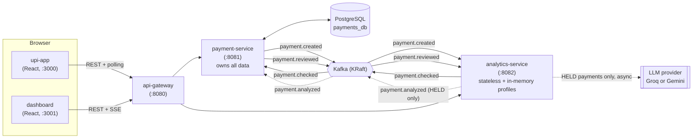

# PayGuard

A UPI fraud-detection system built as event-driven microservices: rules decide, AI explains, and
a reviewer gets the final word.

## Architecture



**Event flow for one payment:**

1. `upi-app` → `POST /api/payments` (via the gateway). `payment-service` saves it as `PENDING_CHECK`
   and, only after the DB transaction commits, publishes `PaymentCreatedEvent` to `payment.created`.
2. `analytics-service` consumes it, runs three in-memory rules against the payer's profile, and
   publishes `PaymentCheckedEvent` (`APPROVED`/`HELD` + reasons + a profile snapshot) to
   `payment.checked` — all synchronous, no network calls, typically sub-millisecond.
3. `payment-service` consumes that, flips the payment to `COMPLETED` or `HELD`, and — if `HELD` —
   opens a `FraudAlert`.
4. Only for `HELD` payments, `analytics-service` asynchronously asks an LLM to explain the alert in
   plain language, publishing `PaymentAnalyzedEvent` to `payment.analyzed` when done (or `FAILED` on
   timeout/error). This never delays step 2.
5. `payment-service` attaches that analysis to the alert.
6. A reviewer in the `dashboard` calls `POST /api/alerts/{id}/decision`. `payment-service` sets the
   payment to `BLOCKED` or `COMPLETED`, updates the alert, and publishes `PaymentReviewedEvent`.
7. `analytics-service` consumes that; on `CLEARED` it adds the device and payee to the payer's known
   lists so the same pattern isn't flagged again.
8. `upi-app` polls `GET /api/payments/{id}` every 2s while the payment is non-final, so the phone
   shows **Processing → Paid / On hold / Blocked** live.

All four topics are keyed by `payerVpa` (3 partitions each), so one payer's events are always
processed in order, even across partitions/consumers.

## Running it

### Option 1 — everything in Docker

```bash
cp .env.example .env   # fill in LLM_API_KEY at minimum
docker compose up --build
```

- upi-app: http://localhost:3000
- dashboard: http://localhost:3001
- api-gateway: http://localhost:8080
- Kafka UI: http://localhost:8090

### Option 2 — infra in Docker, services from IntelliJ

```bash
docker compose up postgres kafka kafka-ui
```

Then run each of `payment-service`, `analytics-service`, `api-gateway` from IntelliJ with the
`local` Spring profile active (`-Dspring.profiles.active=local`), which points them at
`localhost:5433` / `localhost:29092` / `localhost:8081`/`8082` instead of the Docker-internal
hostnames. Run the frontends with `npm run dev` from `upi-app/` and `dashboard/` (ports 3000/3001,
same as Docker).

### Switching LLM providers

`analytics-service` uses the OpenAI-compatible Spring AI starter, so swapping providers is four
env vars in `.env`, no code or rebuild needed beyond a restart:

| | Groq | Gemini |
|---|---|---|
| `LLM_API_KEY` | your Groq key | your Gemini key |
| `LLM_BASE_URL` | `https://api.groq.com/openai` | `https://generativelanguage.googleapis.com/v1beta/openai` |
| `LLM_MODEL` | `llama-3.3-70b-versatile` | a current Gemini flash model (see note below) |
| `LLM_COMPLETIONS_PATH` | `/v1/chat/completions` | `/chat/completions` |

The `completions-path` differs because Spring AI hard-codes `/v1/chat/completions` after the
configured base URL by default; Gemini's OpenAI-compatible endpoint doesn't have that extra `/v1`
segment (it's already versioned via `/v1beta`), so it has to be overridden. Groq's endpoint matches
the Spring AI default, so that one's just there for symmetry.

Gemini model names move fast — `gemini-2.5-flash` has already been retired in favour of newer
models as of this writing. Check `https://ai.google.dev/gemini-api/docs/models` for the current
flash model name if `LLM_MODEL` starts returning 404s.

### Demo script

1. Open the dashboard and the upi-app side by side.
2. Make a normal, small payment from the phone → watch it go Processing → Paid, and show up as
   "checked" in the dashboard's live feed with no alert.
3. Click **"Large payment"** on the phone → it gets held (`LARGE_AMOUNT`). Watch the alert appear in
   the dashboard's review queue in real time (via SSE), with a loading state on the AI panel that
   fills in a few seconds later.
4. In the dashboard, open the case, read the AI's explanation, and click **Clear payment** (or press
   `C`) → watch the phone's result screen flip live from "On hold" to "Paid".
5. Click **"Three payments in two seconds"** or **"New phone, new receiver"** to show the other two
   rules (`VELOCITY`, `NEW_DEVICE_NEW_PAYEE`) tripping.
6. Hit **"AI summary of the last hour"** in the dashboard for a plain-language rollup of everything
   held so far.

## Design decisions

- **Rules decide, AI explains.** Every HELD/APPROVED decision is made synchronously by three
  deterministic, in-memory rules — fast, free, and testable without any network dependency. The LLM
  call only ever runs *after* a HELD verdict has already been published, purely to produce a
  human-readable explanation for the reviewer. If the LLM is slow, down, or rate-limited, the fraud
  decision itself is never affected — only `aiStatus` ends up `FAILED` and the reviewer sees a clear
  message instead of an analysis.
- **payment-service owns all data; analytics-service is stateless apart from in-memory profiles.**
  One system of record avoids dual-write/consistency problems between services, and keeps every
  frontend read (payments, alerts, stats, SSE) backed by one database. analytics-service never
  touches that database or calls payment-service's API — it only sees Kafka events — so it can be
  scaled, restarted, or rewritten independently.
  **Known limitation:** because payer profiles (average amount, known devices/payees, recent
  payment timestamps) live only in a `ConcurrentHashMap` inside analytics-service, a restart loses
  all learned history for every payer — it isn't persisted anywhere. The fix in a real system would
  be to back profiles with Redis (or a compacted Kafka topic the service replays on startup)
  instead of local memory.
- **Events are keyed by `payerVpa`.** Kafka only guarantees ordering within a partition, and every
  rule here (running average, velocity window, known devices/payees) depends on seeing one payer's
  events in the order they happened. Keying by payer — rather than by payment ID — guarantees that,
  while still spreading load across partitions for different payers.
- **Consumers are idempotent.** Kafka delivers at-least-once; a consumer can see the same event
  twice (rebalance, retry, redelivery). `payment-service` persists every processed `eventId` in a
  `processed_events` table and checks it before applying an update; `analytics-service` (no
  database) keeps a bounded in-memory set of recently-seen event ids for the same purpose — smaller
  blast radius if it restarts, since a reprocessed event there would otherwise double-count a
  payment into a payer's profile.
- **A device becomes "known" the moment it's used, regardless of outcome; a payee becomes "known"
  only once a payment to it is actually approved (or a reviewer clears one).** These two signals
  are deliberately asymmetric. "Known device" just means "a device we've seen this payer use
  before" — a weak signal, since recognizing your own phone doesn't depend on every past payment
  from it having gone through clean. "Known payee" is stronger: a destination only earns trust once
  money has actually, successfully gone to it (or a human reviewer vouches for it), so a fraudulent
  destination is never blessed just because someone *attempted* to pay it.
  This distinction matters more than it looks: tying *both* signals to approval creates a deadlock.
  A brand-new payer's first payment is always held (device and payee both unavoidably new — there's
  no history yet), and if nothing is ever recorded except on approval, that payer can never produce
  an approved payment afterwards either, since approval itself requires something to already be
  known. Every payment from every payer would stay held forever. Marking the device known on first
  use (held or not) breaks that cycle: a payer's *second* payment, from the same device, no longer
  trips `NEW_DEVICE_NEW_PAYEE` just because the payee is new — which is what actually gets the
  simulator's traffic down near the intended ~7%-held rate instead of 100%.

## Project layout

```
payment-service/      Spring Boot — owns Postgres, REST API, SSE, Kafka producer/consumer, simulator
analytics-service/    Spring Boot + Spring AI — fraud rules, in-memory profiles, LLM calls, no DB
api-gateway/           Spring Cloud Gateway — single entry point, CORS, SSE passthrough
upi-app/               React + Vite — fake UPI phone app
dashboard/             React + Vite — fraud review dashboard
docker-compose.yml
```

Each Spring service builds and runs independently (its own `pom.xml`, its own multi-stage
Dockerfile) — there's no shared parent POM or shared library between them, matching how the
services are meant to be deployed and evolved separately.
